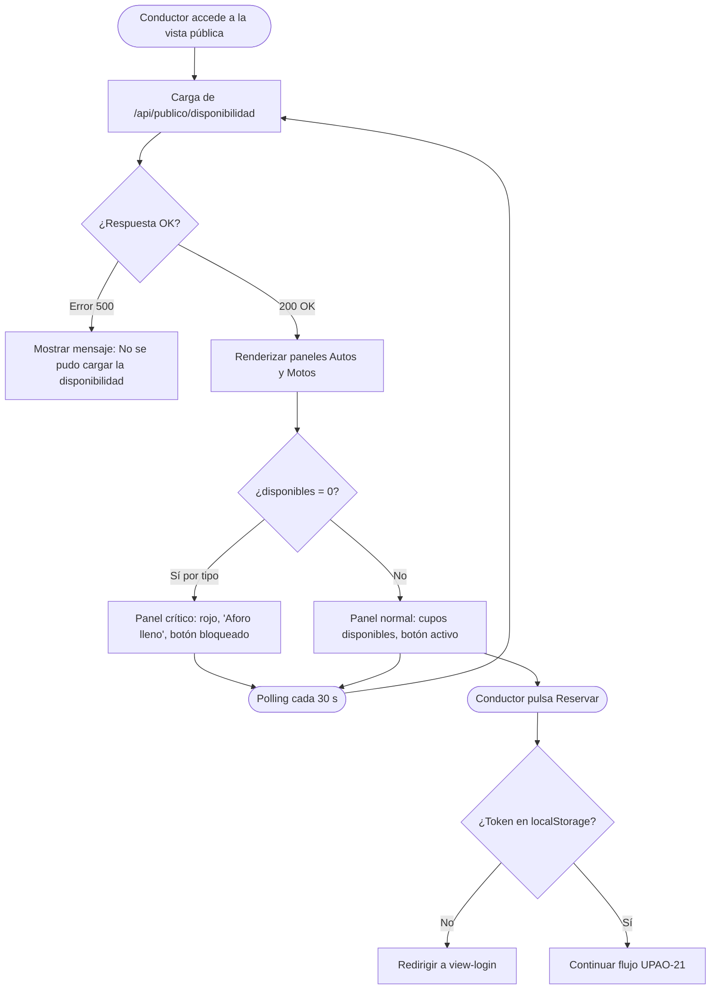

# Módulo Vista Pública de Disponibilidad — Análisis y Diseño (UPAO-20 / Subtarea 4.1)

> **Historia de Usuario:** UPAO-20 — Ver espacios disponibles
> **Épica:** UPAO-28 (Manejo de Reserva Web)
> **Rol:** Conductor (usuario externo, sin sesión obligatoria)
> **Story Points:** 1 SP · Sprint 2
> **Subtarea:** Análisis y diseño de la vista pública de disponibilidad y fórmula de aforo

---

## 1. Objetivo y Justificación de Negocio

### 1.1. Objetivo

Especificar la fórmula de cálculo de disponibilidad de espacios, las reglas de acceso público, la protección del flujo de reserva y el comportamiento visual de aforo cero; garantizando que cualquier conductor pueda consultar cupos sin necesidad de autenticarse, pero que la acción de reservar quede protegida detrás del flujo de Login.

### 1.2. Justificación de Negocio

1. **Transparencia previa a la reserva:** Un conductor necesita conocer los cupos reales antes de desplazarse físicamente a la cochera o de completar un formulario de reserva. Mostrar esta información de forma pública reduce visitas fallidas y mejora la experiencia de usuario.
2. **Integridad del aforo:** La fórmula descuenta tanto los vehículos actualmente dentro (`hora_salida IS NULL`) como las reservas vigentes (futuras confirmadas), evitando sobreventa de espacios.
3. **Seguridad de la reserva:** La acción de reservar requiere identidad (usuario registrado); exponer la consulta de disponibilidad de forma pública no implica exposición de datos sensibles.
4. **Señal de alerta operativa:** Cuando la disponibilidad llega a cero, el panel debe comunicarlo visualmente de forma inequívoca para evitar que el conductor pierda tiempo intentando reservar un espacio inexistente.

---

## 2. Requerimientos y Criterios de Aceptación (UPAO-20)

| ID | Criterio de Aceptación | Solución Técnica |
|:---:|---|---|
| **CA-01** | Consulta de disponibilidad sin sesión activa | Endpoint `GET /api/publico/disponibilidad` sin middleware de autenticación; accesible desde navegador sin token ni cookie de sesión. |
| **CA-02** | Dos paneles independientes (Autos y Motos) | Respuesta JSON con objetos separados `autos` y `motos`, cada uno con `capacidad`, `enCochera`, `reservasVigentes` y `disponibles`. |
| **CA-03** | Fórmula con piso matemático (nunca negativo) | `disponibles = Math.max(0, capacidad - enCochera - reservasVigentes)` aplicada en el servidor. |
| **CA-04** | Actualización en tiempo real | Polling cada **30 segundos** en el frontend mediante `setInterval`; sin WebSockets para mantener compatibilidad con el plan gratuito de Render. |
| **CA-05** | Estado crítico cuando disponibles = 0 | Panel en rojo, etiqueta **"Aforo lleno"** y botón "Reservar" deshabilitado (`disabled` + `aria-disabled="true"`). |
| **CA-06** | Redirección a Login si no hay sesión al reservar | Al pulsar "Reservar", el frontend verifica la existencia de token en `localStorage`; si no existe, redirige a `#view-login` sin llamar a la API. |

---

## 3. Fórmula de Cálculo de Disponibilidad

### 3.1. Definición Formal

$$\text{Disponibles}_{tipo} = \max\!\bigl(0,\ \text{CapacidadTotal}_{tipo} - \text{EnCochera}_{tipo} - \text{ReservasVigentes}_{tipo}\bigr)$$

Donde:

| Término | Definición | Fuente en BD |
|---|---|---|
| $\text{CapacidadTotal}_{tipo}$ | Número máximo de plazas configuradas para el tipo de vehículo | `src/config/espacios.json` → `capacidadAutos` / `capacidadMotos` |
| $\text{EnCochera}_{tipo}$ | Estadías activas con `hora_salida IS NULL` para ese tipo | Tabla `estadia` |
| $\text{ReservasVigentes}_{tipo}$ | Reservas confirmadas cuyo intervalo de tiempo aún no ha vencido | Tabla `reserva` *(a implementar en Sprint futuro; valor = **0** en Sprint 2)* |
| $\max(0,\ \cdot)$ | Piso matemático: impide que el resultado sea negativo ante condiciones de exceso temporal | Función `Math.max` en Node.js |

> **Nota Sprint 2:** La tabla `reserva` **no existe aún** en el esquema Prisma (pertenece al backlog futuro UPAO-21). Durante Sprint 2, `ReservasVigentes` siempre es `0`. La fórmula se diseña con el término explícito para que la subtarea de Codificación (4.3) lo integre sin refactorizar la lógica cuando se implemente UPAO-21.

### 3.2. Implementación de Referencia en Node.js

```js
function calcularDisponibles(capacidad, enCochera, reservasVigentes = 0) {
  return Math.max(0, capacidad - enCochera - reservasVigentes);
}
```

### 3.3. Ejemplo Numérico

| Escenario | Capacidad | En Cochera | Reservas | Resultado bruto | `Math.max(0, ·)` |
|---|---|---|---|---|---|
| Operación normal | 10 | 4 | 1 | 5 | **5** |
| Cochera llena | 10 | 10 | 0 | 0 | **0** |
| Sobrecupo temporal (data race) | 10 | 11 | 0 | −1 | **0** |
| Sin reservas aún (Sprint 2) | 10 | 7 | 0 | 3 | **3** |

---

## 4. Reglas de Acceso y Seguridad

### 4.1. Regla de Acceso Público

- El endpoint `GET /api/publico/disponibilidad` **no requiere token JWT ni cookie de sesión**.
- El servidor **no aplica middleware de autenticación** sobre esta ruta.
- Los datos expuestos son únicamente: `capacidad`, `enCochera`, `reservasVigentes` y `disponibles` para cada tipo de vehículo. No se expone información sensible (placas, usuarios, tarifas).
- La ruta se monta bajo el prefijo `/api/publico/` para distinguirla semánticamente de los endpoints privados y facilitar auditorías futuras de seguridad.

### 4.2. Regla de Seguridad / Redirección al Reservar

El botón **"Reservar espacio"** es el único punto de acción que exige identidad. El flujo es:

```
Usuario pulsa "Reservar"
        │
        ▼
¿Existe token válido en localStorage?
        │
   ┌────┴─────┐
  No          Sí
   │           │
   ▼           ▼
Redirigir   Continuar al
a Login     flujo de reserva
(UPAO-21)
```

**Reglas precisas:**

1. La verificación se realiza **íntegramente en el frontend** antes de cualquier llamada a la API.
2. Se comprueba la existencia de la clave `token` en `localStorage` (misma clave que usa el módulo de autenticación existente en [`public/js/app.js`](../../public/js/app.js)).
3. Si el token **no existe o está vacío**, el sistema muestra todas las secciones con `view-section` y activa `view-login` mediante `classList.add('active')`, sin recargar la página.
4. Si el token **existe**, el flujo de reserva continúa (a implementar en UPAO-21).
5. **No se llama a ningún endpoint de reserva** si no hay sesión; la protección actúa antes de cualquier solicitud de red.

> **Principio de diseño:** La vista pública de disponibilidad es de solo lectura. El backend no necesita proteger `GET /api/publico/disponibilidad`. La protección recae sobre los endpoints de escritura (POST reserva), que sí requerirán autenticación cuando se implementen en UPAO-21.

---

## 5. Regla de Estado Crítico — Aforo Cero

Cuando `disponibles === 0` para un tipo de vehículo, el panel de ese tipo entra en **estado crítico**. Las reglas de comportamiento son:

| Elemento UI | Estado normal | Estado crítico (`disponibles = 0`) |
|---|---|---|
| Borde del panel | Azul corporativo `#1E3A8A` | Rojo peligro `#EF4444` |
| Fondo del panel | Neutro `#F3F4F6` | Rojo suave `#FEF2F2` |
| Etiqueta de disponibilidad | `"X espacios disponibles"` | **`"Aforo lleno"`** en rojo |
| Botón "Reservar" | Habilitado | `disabled` + `aria-disabled="true"` + clase `btn-disabled` |
| Cursor del botón | `pointer` | `not-allowed` |
| Tooltip del botón | — | `"No hay espacios disponibles para este tipo de vehículo"` |

**Reglas adicionales:**

- El estado crítico aplica **por tipo de vehículo de forma independiente**: puede haber aforo lleno en Autos y cupos libres en Motos simultáneamente.
- El estado crítico se recalcula en **cada ciclo de polling** (cada 30 s) y en la carga inicial de la vista.
- El botón deshabilitado **no previene el evento `click` solo con `disabled`** en algunos navegadores móviles; se agrega un guard en el manejador JavaScript:

```js
if (disponibles === 0) return;
```

---

## 6. Especificación del Endpoint Público

### `GET /api/publico/disponibilidad`

**Control de acceso:** Ninguno (público).

**Respuesta 200 OK:**

```json
{
  "autos": {
    "capacidad": 10,
    "enCochera": 7,
    "reservasVigentes": 0,
    "disponibles": 3
  },
  "motos": {
    "capacidad": 10,
    "enCochera": 10,
    "reservasVigentes": 0,
    "disponibles": 0
  },
  "total": {
    "capacidad": 20,
    "enCochera": 17,
    "reservasVigentes": 0,
    "disponibles": 3
  },
  "ultimaActualizacion": "2026-11-05T05:48:00.000Z"
}
```

**Respuesta 500 Internal Server Error:**

```json
{
  "error": "No se pudo consultar la disponibilidad de espacios."
}
```

**Notas de implementación:**

- El campo `reservasVigentes` siempre devuelve `0` en Sprint 2 (tabla `reserva` pendiente).
- El campo `ultimaActualizacion` corresponde a `new Date().toISOString()` del momento del cálculo en servidor.
- La ruta se registra en `server.js` **antes** del handler 404 genérico y **sin** middleware de autenticación.

---

## 7. Diseño de Interfaz de Usuario (UI/UX)

Siguiendo la [Guía de Estilos y Lineamientos de Interfaz](../../diseño/Guía%20de%20Estilos%20y%20Lineamientos%20de%20Interfaz.md):

- **Tipografía:** Geist Sans (etiquetas, textos) · JetBrains Mono (contadores numéricos de cupos).
- **Colores:** Azul `#1E3A8A` (normal) · Rojo `#EF4444` (crítico) · Fondo `#F3F4F6`.

### 7.1. Wireframe Conceptual

```text
┌─────────────────────────────────────────────────────────────────┐
│  🅿 COCHERA SP — Disponibilidad en Tiempo Real                   │
│  Consulta sin necesidad de cuenta                               │
├───────────────────────────┬─────────────────────────────────────┤
│  🚗 Automóviles           │  🏍 Motocicletas                    │
│                           │                                     │
│  Capacidad total: 10      │  Capacidad total: 10                │
│  En cochera:       7      │  En cochera:      10                │
│  Reservas:         0      │  Reservas:         0                │
│                           │                                     │
│  ┌────────────────────┐   │  ┌──────────────────────────────┐  │
│  │  3 espacios disp.  │   │  │  🔴 Aforo lleno              │  │
│  └────────────────────┘   │  └──────────────────────────────┘  │
│                           │                                     │
│  [ Reservar espacio ]     │  [ Reservar espacio ] (bloqueado)  │
│                           │                                     │
│  Actualizado: 00:48:00    │  Actualizado: 00:48:00             │
└───────────────────────────┴─────────────────────────────────────┘
  ⓘ Al hacer clic en «Reservar» deberás iniciar sesión.
```

### 7.2. Comportamiento Responsive

- En pantallas móviles (< 640 px) los dos paneles se apilan verticalmente.
- El botón "Reservar" ocupa el ancho completo de su panel en mobile.

---

## 8. Diagrama de Flujo — Interacción del Conductor



---

## 9. Integración con el Sistema Existente

| Punto de integración | Referencia | Observación |
|---|---|---|
| Capacidad de espacios | [`src/config/espacios.json`](../../../src/config/espacios.json) + [`src/config/espacios.js`](../../../src/config/espacios.js) | Reutilizar `obtenerCapacidad()` existente |
| Conteo de estadías activas | [`src/routes/espacios.js`](../../../src/routes/espacios.js) → `obtenerEstadiasActivasPorTipo()` | Extraer a función compartida o duplicar consulta Prisma |
| Verificación de token en frontend | [`public/js/app.js`](../../../public/js/app.js) | Usar la misma clave `localStorage` que el módulo de auth |
| Registro de la ruta pública | [`server.js`](../../../server.js) | Montar **antes** del middleware 404 y **sin** autenticación |
| Estilos de estado crítico | [`public/css/style.css`](../../../public/css/style.css) | Agregar clases `.panel-lleno`, `.btn-reservar:disabled` siguiendo la paleta existente |

---

## 10. Plan de Trabajo por Subtareas (Scrum)

| # | Subtarea | Tipo | Estimación |
|---|---|---|---|
| 4.1 | **Este documento** — Análisis y diseño de la vista pública y fórmula de aforo | Análisis y Diseño | 2 h |
| 4.2 | Prototipar interfaz pública de disponibilidad con indicadores de cupos y alertas | Prototipado | 3 h |
| 4.3 | Programar endpoint `GET /api/publico/disponibilidad` y lógica de redirección al reservar | Codificación | 4 h |
| 4.4 | Probar vista pública: fórmula, aforo cero, redirección y no regresión | Test | 3 h |
| 4.5 | PR a `develop`, despliegue y verificación en ambiente Blue (Staging) | Configuración | 1 h |

---

## 11. Lista de Verificación de Criterios (Conformidad de Diseño)

- [x] **Fórmula especificada:** `Disponibles = Math.max(0, Capacidad - EnCochera - ReservasVigentes)`.
- [x] **Término `reservasVigentes` incluido** con valor `0` en Sprint 2 y listo para UPAO-21.
- [x] **Acceso público definido:** `GET /api/publico/disponibilidad` sin autenticación.
- [x] **Regla de redirección especificada:** verificación de `localStorage` antes de llamar a la API de reserva.
- [x] **Estado crítico especificado:** rojo, etiqueta "Aforo lleno", botón `disabled` + guard JS.
- [x] **Estado crítico independiente por tipo** de vehículo.
- [x] **Polling de 30 s** definido como mecanismo de actualización en tiempo real.
- [x] **Integración con módulos existentes** referenciada (espacios, auth, estilos).
- [x] **Sin exposición de datos sensibles** en el endpoint público.
