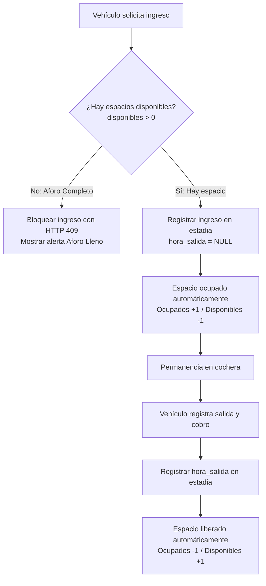

# Módulo Espacios y Aforo — Análisis y Diseño (UPAO-11)

> Historia: **UPAO-11 Ver estado de espacios** · Subtarea **UPAO-49 (Programar la lógica del estado de espacios)** · Sprint 1.

---

## 1. Objetivo

Definir la **lógica de control de aforo y estado de espacios** de la cochera basada en **totales consolidados** por tipo de vehículo (Autos y Motos), sin asignación de plazas individuales, y asegurar que el sistema gestione automáticamente los cambios de disponibilidad al ingresar (HU-01) o salir (HU-02).

---

## 2. Alcance y Reglas de Negocio

- **Sin plazas individuales numeradas:** El conductor ingresa y encuentra un espacio libre por su propia cuenta. El sistema no asigna ni reserva identificadores individuales (`A-01`, etc.).
- **Disponibilidad derivada en tiempo real:**
  $$\text{Espacios Disponibles} = \text{Capacidad Máxima} - \text{Estadías Activas (hora\_salida IS NULL)}$$
- **Cambio automático al Ingresar (HU-01):**
  - Al solicitar un ingreso, el sistema valida si $\text{disponibles} > 0$ para esa categoría.
  - Si el sector está lleno ($\text{disponibles} = 0$), el sistema **bloquea el ingreso con HTTP 409 Conflict** (*"No hay espacios disponibles para [tipo]. Aforo completo."*).
  - Si hay disponibilidad, se registra la estadía, lo que automáticamente aumenta los ocupados en 1 y disminuye los disponibles en 1.
- **Cambio automático al Salir (HU-02):**
  - Al registrar la salida y cobro de un vehículo, se establece `hora_salida`.
  - La estadía deja de ser activa, liberando el espacio de forma inmediata ($\text{ocupados} - 1$, $\text{disponibles} + 1$).
- **Configuración de capacidad por el Dueño:**
  - El dueño puede consultar y ajustar la capacidad total de autos y motos según la necesidad operativa del local, con validación de que no sea menor a los vehículos actualmente dentro.

---

## 3. Flujo del Control de Aforo

---

## 4. Estructura de Datos (Sin cambios en BD)

La tabla **`estadia`** existente en PostgreSQL/Prisma modela perfectamente el aforo:
- Una estadía activa es aquella con `hora_salida IS NULL`.
- El conteo se realiza por `id_tipo_vehiculo` (Automóvil / Camioneta vs Motocicleta).
- La capacidad máxima se gestiona en la configuración del servidor (`src/config/espacios.json`) con valores iniciales configurables por variable de entorno (`CAPACIDAD_AUTOS` y `CAPACIDAD_MOTOS`, defecto 10 y 10).

---

## 5. Endpoints Desarrollados en Backend (UPAO-49)

| Método | Endpoint | Rol | Descripción |
| --- | --- | --- | --- |
| `GET` | `/api/espacios` | Todos | Consulta el aforo consolidado (capacidad, ocupados, disponibles, porcentajes y semáforo). |
| `PUT` | `/api/espacios/capacidad` | Dueño | Actualiza la capacidad máxima de autos y/o motos con validación de no exceder los vehículos ya dentro. |

---

## 6. Lista de Verificación de Criterios (Checks de Conformidad)

Conformidad de los requerimientos planificados para esta tarea de lógica:

- [x] **Consulta de estado en backend:** Implementado endpoint `GET /api/espacios` que retorna el estado actualizado en tiempo real.
- [x] **Aforo por totales (sin plazas fijas):** Control por contadores generales de Autos y Motos, permitiendo que el conductor se ubique libremente.
- [x] **Control preventivo en ingreso (HU-01):** Verificación de disponibilidad previa en `POST /api/ingresos`; bloqueo con código 409 si el aforo está al 100%.
- [x] **Transición automática a Ocupado:** Al crearse la estadía (`horaSalida: null`), el vehículo computa inmediatamente como ocupado.
- [x] **Transición automática a Disponible en salida (HU-02):** Al registrarse `horaSalida`, el espacio queda libre sin requerir banderas manuales.
- [x] **Gestión de capacidad para el Dueño:** Endpoint `PUT /api/espacios/capacidad` con validación de integridad (no permite fijar capacidad menor a los vehículos actualmente dentro).
- [x] **Semáforo dinámico:** Cálculo de estado visual (`DISPONIBLE`, `MEDIO`, `LLENO`) según el porcentaje de ocupación total.
