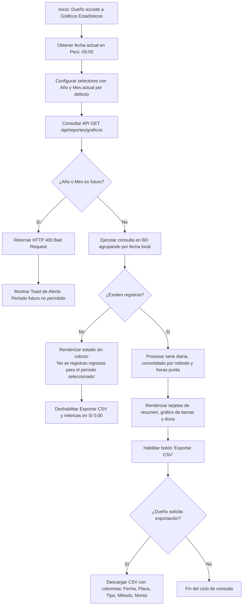

# Módulo Gráficos Estadísticos — Análisis y Diseño (UPAO-18 / Subtarea 2.1)

> **Historia de Usuario:** UPAO-18 — Gráficos de ingresos
> **Épica:** UPAO-27 (Administración y Supervisión del Negocio)
> **Rol:** Dueño
> **Story Points:** 5 SP · Sprint 2
> **Subtarea:** 2.1 — Análisis y diseño de métricas estadísticas mensuales, concurrencia y exportación

---

## 1. Objetivo y Justificación de Negocio

### 1.1. Objetivo
Definir la arquitectura de consulta en base de datos, reglas de validación temporal, estructura de datos multidimensional (ingresos monetarios y concurrencia vehicular) y especificación de exportación financiera para permitir que el Dueño analice el comportamiento económico de la cochera tanto a nivel mensual (desglose por días y métodos de pago) como a nivel anual (visión histórica consolidada mes a mes), facilitando la toma de decisiones tarifarias.

### 1.2. Justificación de Negocio
El dueño de la cochera requiere conocer con precisión:
1. **Patrones de demanda:** Identificar qué días del mes y qué franjas horarias concentran la mayor afluencia de vehículos para proyectar requerimientos de personal o evaluar ajustes en las tarifas por hora/fracción.
2. **Arqueo y penetración de pagos:** Comparar el volumen y porcentaje de recaudación entre **dinero físico (Efectivo)** y **dinero digital (Yape)** para cuadre de caja y convenios financieros.
3. **Tendencias intermensuales:** Evaluar el crecimiento anual mes a mes para medir la rentabilidad del negocio a lo largo de las distintas temporadas del año.
4. **Portabilidad de auditoría:** Disponer de exportaciones inmediatas en CSV/Excel para contabilidad externa o auditorías tributarias en formato estándar peruano.

---

## 2. Requerimientos y Criterios de Aceptación (UPAO-18)

| ID | Criterio de Aceptación | Solución Técnica de Análisis y Diseño |
|:---:|---|---|
| **CA-01** | Selector interactivo de mes y año con carga inicial por defecto | El backend y frontend determinan el año y mes en curso según hora peruana (`America/Lima`, UTC-5). El selector inicia en el mes corriente. |
| **CA-02** | Restricción estricta de fechas/períodos futuros | Validación dual (frontend y backend): se bloquea la selección y se rechaza con `HTTP 400` cualquier consulta con año posterior al actual o mes futuro dentro del año corriente. |
| **CA-03** | Visualización de ingresos y concurrencia por día del mes | Agrupación diaria (días del 1 al 28/29/30/31 del mes elegido) con suma de montos (`S/ 0.00`) y conteo de vehículos atendidos. |
| **CA-04** | Desglose por método de pago (Efectivo vs. Yape) | Agrupación por `id_metodo_pago` y cálculo de totales acumulados, porcentajes y cantidad de transacciones. |
| **CA-05** | Vista consolidada anual general | Posibilidad de seleccionar vista Anual para contrastar los 12 meses de un año específico (ingresos totales y afluencia por mes). |
| **CA-06** | Formato de moneda estricto peruano | Todos los importes en ejes, tooltips, tablas y resúmenes se expresan en soles con prefijo `S/` y dos decimales (`S/ 0.00`). |
| **CA-07** | Estado sin cobros registrados | Si el período consultado no tiene movimientos, se despliega el mensaje exacto: `"No se registran ingresos para el período seleccionado"`, sin errores de renderizado. |
| **CA-08** | Exportación de datos financieros | Generación de archivo descargable en formato CSV compatible con Excel con las columnas requeridas: `Fecha`, `Placa`, `Tipo`, `Método`, `Monto`. |

---

## 3. Estructura de Consulta en Base de Datos (SQL / Prisma)

### 3.1. Consideración de Zona Horaria (Perú UTC-5 / `America/Lima`)
Las marcas de tiempo de cobro en la tabla `pago` (`fecha_hora`) y en la tabla `estadia` (`hora_ingreso`, `hora_salida`) se almacenan en formato UTC (estándar PostgreSQL/Neon).
Para evitar distorsiones en los cierres de medianoche (por ejemplo, transacciones ocurridas entre las 19:00 y 23:59 de Lima que caerían en el día siguiente en UTC):
- **Cálculo de límites en Node.js:** Se definen los límites `inicioPeriodo` y `finPeriodo` expresados con el offset `-05:00`:

```javascript
// Ejemplo mes: Octubre 2026
const inicioMes = new Date(`${anio}-${String(mes).padStart(2, '0')}-01T00:00:00.000-05:00`);
// Último milisegundo del mes
const ultimoDia = new Date(anio, mes, 0).getDate();
const finMes = new Date(`${anio}-${String(mes).padStart(2, '0')}-${ultimoDia}T23:59:59.999-05:00`);
```

- **Conversión SQL en PostgreSQL:**
  Se utiliza el operador estándar `AT TIME ZONE 'America/Lima'` para extraer el día, hora o mes en la zona local peruana:

```sql
(p.fecha_hora AT TIME ZONE 'UTC' AT TIME ZONE 'America/Lima')
```

---

### 3.2. Consulta SQL: Agrupación Mensual Diaria por Método de Pago
Esta consulta agrupa los pagos del mes seleccionado por día del mes y por método de pago (`Efectivo` vs. `Yape`), calculando la recaudación total y la cantidad de vehículos (concurrencia):

```sql
-- Parámetros: $1 = Timestamp inicio de mes (UTC), $2 = Timestamp fin de mes (UTC)
SELECT 
    EXTRACT(DAY FROM (p.fecha_hora AT TIME ZONE 'America/Lima'))::INTEGER AS dia,
    TO_CHAR((p.fecha_hora AT TIME ZONE 'America/Lima'), 'YYYY-MM-DD') AS fecha_peru,
    mp.nombre AS metodo_pago,
    COUNT(p.id_pago)::INTEGER AS total_vehiculos,
    COALESCE(SUM(p.monto), 0)::NUMERIC(10, 2) AS total_monto
FROM pago p
INNER JOIN metodo_pago mp ON p.id_metodo_pago = mp.id_metodo_pago
WHERE p.fecha_hora >= $1 AND p.fecha_hora <= $2
GROUP BY 
    dia, 
    fecha_peru, 
    mp.nombre
ORDER BY 
    dia ASC, 
    mp.nombre ASC;
```

#### Agrupación de Concurrencia por Horas (Mapa de Demanda del Mes)
Para identificar las horas punta de mayor afluencia requeridas por la historia de usuario:

```sql
SELECT 
    EXTRACT(HOUR FROM (p.fecha_hora AT TIME ZONE 'America/Lima'))::INTEGER AS hora_dia,
    COUNT(p.id_pago)::INTEGER AS concurrencia_vehiculos,
    COALESCE(SUM(p.monto), 0)::NUMERIC(10, 2) AS total_recaudado
FROM pago p
WHERE p.fecha_hora >= $1 AND p.fecha_hora <= $2
GROUP BY hora_dia
ORDER BY hora_dia ASC;
```

---

### 3.3. Consulta SQL: Consolidado Anual General (Mes a Mes)
Permite al dueño visualizar la evolución financiera a lo largo de un año completo (de Enero a Diciembre):

```sql
-- Parámetros: $1 = Inicio de año 'YYYY-01-01T00:00:00-05:00', $2 = Fin de año 'YYYY-12-31T23:59:59.999-05:00'
SELECT 
    EXTRACT(MONTH FROM (p.fecha_hora AT TIME ZONE 'America/Lima'))::INTEGER AS numero_mes,
    TO_CHAR((p.fecha_hora AT TIME ZONE 'America/Lima'), 'TMMonth') AS nombre_mes,
    mp.nombre AS metodo_pago,
    COUNT(p.id_pago)::INTEGER AS total_vehiculos,
    COALESCE(SUM(p.monto), 0)::NUMERIC(10, 2) AS total_monto
FROM pago p
INNER JOIN metodo_pago mp ON p.id_metodo_pago = mp.id_metodo_pago
WHERE p.fecha_hora >= $1 AND p.fecha_hora <= $2
GROUP BY 
    numero_mes, 
    nombre_mes, 
    mp.nombre
ORDER BY 
    numero_mes ASC, 
    mp.nombre ASC;
```

---

### 3.4. Implementación con Prisma ORM
En el backend Node.js / Express con Prisma, se contemplan dos estrategias complementarias:

1. **Estrategia A (Prisma Raw Query para alto rendimiento):**

```javascript
const desgloseDiario = await prisma.$queryRaw`
  SELECT 
    EXTRACT(DAY FROM (p.fecha_hora AT TIME ZONE 'America/Lima'))::INTEGER AS dia,
    mp.nombre AS metodo,
    COUNT(p.id_pago)::INTEGER AS vehiculos,
    COALESCE(SUM(p.monto), 0)::FLOAT AS monto
  FROM pago p
  INNER JOIN metodo_pago mp ON p.id_metodo_pago = mp.id_metodo_pago
  WHERE p.fecha_hora >= ${inicioMes} AND p.fecha_hora <= ${finMes}
  GROUP BY dia, mp.nombre
  ORDER BY dia ASC;
`;
```

2. **Estrategia B (Prisma Client Estructurado + In-Memory Aggregation):**
   Garantiza interoperabilidad completa y tipado estricto:

```javascript
const pagosMes = await prisma.pago.findMany({
  where: {
    fechaHora: {
      gte: inicioMes,
      lte: finMes
    }
  },
  include: {
    metodoPago: true,
    estadia: {
      include: { tipoVehiculo: true }
    }
  },
  orderBy: { fechaHora: 'asc' }
});
```

---

## 4. Validaciones de Consulta y Restricción Temporal

### 4.1. Carga por Defecto
Al abrir la pantalla, si el frontend no envía parámetros de mes o año:
- El backend calcula la fecha y hora de Lima actual (`Intl.DateTimeFormat` con `timeZone: 'America/Lima'`).
- Establece por defecto: `anio = anioActual` y `mes = mesActual`.

### 4.2. Matriz de Validaciones de Parámetros
Cualquier petición a los endpoints analíticos se somete al siguiente pipeline de control de seguridad:

| Regla | Condición / Entrada | Código HTTP | Mensaje de Error Retornado |
|---|---|:---:|---|
| **Año obligatorio y numérico** | `isNaN(anio)` o `< 2024` | `400 Bad Request` | `"Año de consulta inválido. Ingrese un año válido a partir del 2024."` |
| **Mes obligatorio en vista mensual** | `isNaN(mes)` o `mes < 1` o `mes > 12` | `400 Bad Request` | `"Mes de consulta inválido. El mes debe estar comprendido entre 1 y 12."` |
| **Restricción estricta de año futuro** | `anio > anioActualPeru` | `400 Bad Request` | `"No se pueden consultar períodos futuros. El año seleccionado es posterior al año actual."` |
| **Restricción estricta de mes futuro** | `anio === anioActualPeru && mes > mesActualPeru` | `400 Bad Request` | `"No se pueden consultar meses futuros. Seleccione el mes actual o uno anterior."` |
| **Tipo de reporte válido** | `tipo !== 'mensual' && tipo !== 'anual'` | `400 Bad Request` | `"Tipo de reporte no soportado. Valores permitidos: 'mensual' o 'anual'."` |

---

## 5. Especificación del Formato de Exportación Financiera (CSV / Excel)

### 5.1. Protocolo y Cabeceras HTTP
- **Ruta:** `GET /api/reportes/exportar?periodo=mensual&anio=YYYY&mes=MM` (o `periodo=anual&anio=YYYY`)
- **Cabeceras de respuesta:**
  - `Content-Type: text/csv; charset=utf-8`
  - `Content-Disposition: attachment; filename="reporte_ingresos_2026_10.csv"`
- **Compatibilidad con Microsoft Excel:**
  Para evitar que Excel desfigure caracteres con tilde (como "Automóvil") o la letra "ñ", el archivo debe comenzar obligatoriamente con el byte order mark **UTF-8 BOM** (`\uFEFF`).

### 5.2. Columnas Obligatorias
El archivo CSV estructurado debe cumplir exactamente con las columnas requeridas:

| # | Columna | Tipo de Dato | Formato de Presentación | Ejemplo |
|:---:|---|---|---|---|
| 1 | **Fecha** | Texto / Timestamp | `DD/MM/YYYY HH:mm` (hora local de Perú) | `14/10/2026 09:45` |
| 2 | **Placa** | Texto | Mayúsculas con guion `[A-Z0-9]{3}-[A-Z0-9]{3}` | `ABC-123` |
| 3 | **Tipo** | Texto | Nombre descriptivo de la categoría vehicular | `Automóvil / Camioneta` |
| 4 | **Método** | Texto | Nombre del canal de pago | `Efectivo` o `Yape` |
| 5 | **Monto** | Numérico con moneda | `S/ 0.00` (o decimal `0.00` con encabezado `Monto (S/)`) | `S/ 7.50` |

### 5.3. Estructura y Ejemplo del Archivo CSV

```csv
"Fecha","Placa","Tipo","Método","Monto"
"01/10/2026 08:30","WAS-A12","Motocicleta","Efectivo","S/ 5.00"
"01/10/2026 10:15","G7Y-UAW","Automóvil / Camioneta","Yape","S/ 12.50"
"02/10/2026 14:20","TRA-GA6","Motocicleta","Efectivo","S/ 8.00"
"03/10/2026 18:45","BCA-987","Automóvil / Camioneta","Efectivo","S/ 15.00"
---
"TOTAL RECAUDADO","","","","S/ 40.50"
"TOTAL EFECTIVO","","","","S/ 28.00"
"TOTAL YAPE","","","","S/ 12.50"
"TOTAL VEHÍCULOS ATENDIDOS","","","","4"
```

---

## 6. Comportamiento Visual y Estados de Interfaz

### 6.1. Vista General del Dashboard Estadístico
La interfaz responderá al rol de **Dueño**, respetando la [Guía de Estilos](../../diseño/Guía%20de%20Estilos%20y%20Lineamientos%20de%20Interfaz.md):

```text
┌────────────────────────────────────────────────────────────────────────────────────────┐
│  Estadísticas y Concurrencia Mensual / Anual                          [← Volver al Menú]│
│  Análisis gráfico de recaudación económica y demanda vehicular                          │
├────────────────────────────────────────────────────────────────────────────────────────┤
│  [ Selector Modo: (•) Mensual  ( ) Anual ]                                             │
│  Año: [ 2026 ▼ ]   Mes: [ Octubre ▼ ]   [ Consultar ]   [ 📥 Exportar CSV ]            │
├────────────────────────────────────────────────────────────────────────────────────────┤
│  [ TARJETA 1 ]            [ TARJETA 2 ]            [ TARJETA 3 ]            [ TARJETA 4 ]│
│  Recaudación Total         Total Efectivo           Total Yape               Total Vehículos  │
│  S/ 3,450.00               S/ 2,100.00              S/ 1,350.00              248 atendidos│
├────────────────────────────────────────────────────────────────────────────────────────┤
│  ┌───────────────────────────────────────────┐ ┌──────────────────────────────────────┐│
│  │ GRÁFICO 1: Ingresos Diarios del Mes       │ │ GRÁFICO 2: Distribución por Método   ││
│  │ (Barras / Líneas: Eje X = Días 1..31,     │ │ (Dona / Torta: Efectivo vs. Yape)    ││
│  │  Eje Y = Monto S/)                        │ │ Efectivo: 60.9% | Yape: 39.1%        ││
│  └───────────────────────────────────────────┘ └──────────────────────────────────────┘│
│  ┌────────────────────────────────────────────────────────────────────────────────────┐│
│  │ GRÁFICO 3: Concurrencia Vehicular por Horas (Horas Punta del Período)             ││
│  │ (Barras de afluencia por hora: 06:00 a 23:00 para detección de sobredemanda)       ││
│  └────────────────────────────────────────────────────────────────────────────────────┘│
└────────────────────────────────────────────────────────────────────────────────────────┘
```

---

### 6.2. Comportamiento Visual ante Período sin Cobros Registrados
Cuando el usuario consulte un mes en el que no se hayan generado salidas ni cobros:

```text
┌────────────────────────────────────────────────────────────────────────────────────────┐
│                                                                                        │
│                                  📊                                                    │
│               No se registran ingresos para el período seleccionado                    │
│                                                                                        │
│      No existen transacciones ni cobros de vehículos en el período indicado.          │
│      Puede seleccionar un mes o año anterior para revisar el histórico del negocio.   │
│                                                                                        │
└────────────────────────────────────────────────────────────────────────────────────────┘
```

#### Reglas de presentación para el estado vacío:
1. **Mensaje exacto:** Mostrar textualmente `"No se registran ingresos para el período seleccionado"`.
2. **Semántica informativa:** No usar fondos rojos `#EF4444` (no es un error del sistema ni falla de conexión). Se utiliza un contenedor limpio con borde suave `#E5E7EB`, fondo `#F9FAFB` y tipografía corporativa **Geist Sans**.
3. **Métricas en cero:** Las tarjetas de métricas muestran `S/ 0.00` y `0 vehículos`, formateados en **JetBrains Mono**.
4. **Desactivación del botón de exportación:** El botón `Exportar CSV` se deshabilita visualmente (`cursor: not-allowed`, opacidad 50%) con un tooltip: `"No hay datos disponibles para exportar"`.
5. **Ejes de gráficos estables:** Los lienzos gráficos no se rompen; muestran un estado neutral con ejes limpios o quedan reemplazados temporalmente por el bloque informativo.

---

## 7. Diagrama de Flujo del Proceso



---

## 8. Definición de Endpoints para la Siguiente Subtarea (Codificación)

Para alimentar el prototipo y la posterior implementación se formalizan las rutas:

1. **`GET /api/reportes/graficos`**
   - **Query Params:** `periodo` (`mensual`|`anual`), `anio` (`YYYY`), `mes` (`1..12`, requerido si `periodo=mensual`).
   - **Respuesta `200 OK`:**

```json
{
  "periodo": "mensual",
  "anio": 2026,
  "mes": 10,
  "etiquetaPeriodo": "Octubre 2026",
  "tieneDatos": true,
  "totales": {
    "totalGeneral": 3450.00,
    "totalEfectivo": 2100.00,
    "totalYape": 1350.00,
    "concurrenciaTotal": 248,
    "porcentajeEfectivo": 60.87,
    "porcentajeYape": 39.13
  },
  "serieDiaria": [
    { "dia": 1, "monto": 120.00, "efectivo": 70.00, "yape": 50.00, "vehiculos": 12 }
  ],
  "concurrenciaHoraria": [
    { "hora": 8, "vehiculos": 15 },
    { "hora": 9, "vehiculos": 22 }
  ],
  "serieMensual": []
}
```

2. **`GET /api/reportes/exportar`**
   - **Query Params:** `periodo`, `anio`, `mes`.
   - **Respuesta `200 OK`:** Archivo binario/texto CSV con `Content-Disposition: attachment`.

---

## 9. Checklist de Aceptación de Análisis y Diseño (DoD Subtarea 2.1)

- [x] Estructura de consulta SQL y Prisma definida con conversión a hora local peruana (`-05:00`).
- [x] Agrupación por días del mes y por métodos de pago (Efectivo vs. Yape) modelada.
- [x] Soporte para granularidad mensual y anual general (mes a mes).
- [x] Reglas de validación estricta para evitar consultas de meses o años futuros.
- [x] Especificación técnica de exportación CSV con codificación UTF-8 BOM y columnas obligatorias: `Fecha`, `Placa`, `Tipo`, `Método`, `Monto`.
- [x] Diseño del comportamiento visual ante períodos vacíos con el mensaje textual requerido.
- [x] Documento integrado en la estructura oficial `docs/modulos/graficosEstadisticos/analisis.md`.
