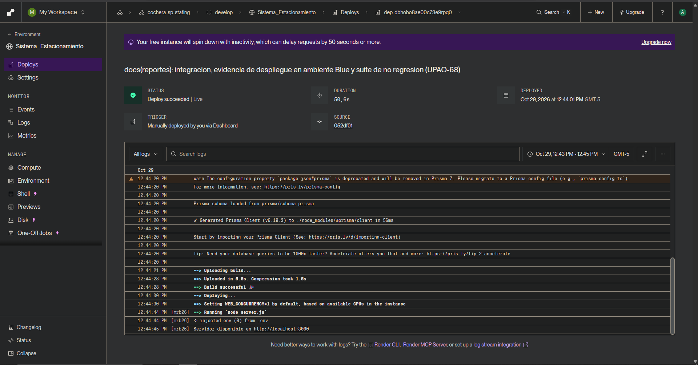

# Evidencia de Despliegue en Ambiente Blue (Staging) — Módulo Gráficos de Ingresos (UPAO-68 / Historia UPAO-18 / Sprint 2)

**Fecha de Integración y Despliegue:** 29/10/2026  
**Ambiente:** Blue (Staging / Pre-producción) en Render  
**Base de Datos en la Nube:** PostgreSQL en Neon (Rama `staging`, SSL activo)  
**Historia de Usuario Asociada:** UPAO-18 (*Gráficos de ingresos* — 5 Story Points)  
**Épica:** UPAO-27 (*Administración y Supervisión del Negocio*)

---

## 1. Enlaces Principales del Despliegue y Repositorio

| Recurso | Descripción | Enlace Directo |
|---|---|---|
| **Rama con Todos los Cambios (`develop`)** | Rama integrada del Sprint 2 con todo el módulo de gráficos y no regresión | [anthonyepv-ctrl/Sistema_Estacionamiento (Rama develop)](https://github.com/anthonyepv-ctrl/Sistema_Estacionamiento/tree/develop) |
| **Rama de la Subtarea UPAO-68** | Rama feature aislada de la subtarea de despliegue | [feature/UPAO-68-despliegue-ambiente-blue](https://github.com/anthonyepv-ctrl/Sistema_Estacionamiento/tree/feature/UPAO-68-despliegue-ambiente-blue) |
| **Comparativa de Cambios (`develop` vs `main`)** | Diff completo de todos los archivos y módulos incorporados frente a producción | [Diff develop...main en GitHub](https://github.com/anthonyepv-ctrl/Sistema_Estacionamiento/compare/main...develop) |
| **Commit de Integración y Despliegue** | Commit desplegado en Render Staging (`052df01`) | [Commit `052df01`](https://github.com/anthonyepv-ctrl/Sistema_Estacionamiento/commit/052df01) |
| **Ambiente Blue en Vivo (Staging)** | Servicio web desplegado en Render conectado a Neon Staging | [https://sistema-estacionamiento-yk2d.onrender.com](https://sistema-estacionamiento-yk2d.onrender.com) |
| **Ambiente Green (Producción)** | Aislado e intacto en rama `main` (despliegue final al cierre de sprint) | [https://cochera-sp.onrender.com](https://cochera-sp.onrender.com) |

---

## 2. Captura y Verificación del Despliegue en Render (Ambiente Blue)

El despliegue fue ejecutado y validado en el Web Service de Render **`Sistema_Estacionamiento`** sobre la rama **`develop`**:



### Ficha Técnica del Despliegue en Render:

* **ID de Despliegue (Deploy ID):** `dep-dbhobo8ae00c73e9rpq0`
* **Entorno / Workspace:** `cochera-sp-stating` / `develop`
* **Estado del Servicio:** `Deploy succeeded | Live` (Activo y saludable)
* **Fecha y Hora de Despliegue:** 29 de octubre de 2026, 12:44:01 PM GMT-5
* **Duración del Proceso de Build:** 50.6 segundos
* **Commit Fuente Desplegado:** [`052df01`](https://github.com/anthonyepv-ctrl/Sistema_Estacionamiento/commit/052df01)
* **Mensaje del Commit:** `docs(reportes): integracion, evidencia de despliegue en ambiente Blue y suite de no regresion (UPAO-68)`
* **Logs Clave del Build & Deploy:**
  ```text
  Prisma schema loaded from prisma/schema.prisma
  ✔ Generated Prisma Client (v6.19.3) to ./node_modules/@prisma/client in 56ms
  ==> Uploading build...
  ==> Build successful 🚀
  ==> Deploying...
  ==> Running 'node server.js'
  Servidor disponible en http://localhost:3000
  ```

---

## 3. Evidencias de Pruebas, Calidad y No Regresión

Todas las suites de prueba fueron ejecutadas y validadas con 100% de éxito antes del pase al ambiente Blue:

| Recurso / Suite | Tipo de Evidencia | Ubicación en Repositorio |
|---|---|---|
| **Video Demostrativo MP4** | Grabación E2E automatizada con cursor visible del flujo completo de gráficos | [`demostracion_pruebas_graficos_upao67.mp4`](evidencias/demostracion_pruebas_graficos_upao67.mp4) |
| **Plan de Pruebas y Defect Log** | Matriz de 8 casos de prueba y resolución de 3 defectos (DEF-01, DEF-02, DEF-03) | [`plan-pruebas.md`](plan-pruebas.md) |
| **Suite E2E Playwright** | 20 verificaciones visuales y de interacción automática | [`tests/e2e-graficos-estadisticos.js`](../../../tests/e2e-graficos-estadisticos.js) |
| **Suite de API y Agregación** | 6 pruebas unitarias/integración de agregaciones y validación defensiva | [`tests/test-graficos-mes.js`](../../../tests/test-graficos-mes.js) |
| **Suite de Aseguramiento de No Regresión** | 5 verificaciones de compatibilidad con módulos previos (diario, aforo, salidas) | [`tests/test-no-regresion.js`](../../../tests/test-no-regresion.js) |

### 3.1. Resultados de la Suite de No Regresión (REG-01 a REG-05)

```text
--- Verificando Aseguramiento de No Regresión (UPAO-68) ---
[REG-01] Validando endpoint histórico de Reporte Diario...
✓ REG-01 EXITOSO: Reporte diario funciona sin regresión.
[REG-02] Validando reporte diario sin parámetros (fecha de hoy)...
✓ REG-02 EXITOSO: Consulta del día actual intacta.
[REG-03] Validando módulo de espacios y aforo...
✓ REG-03 EXITOSO: Módulo de espacios intacto.
[REG-04] Validando métodos de pago en salidas...
✓ REG-04 EXITOSO: Catálogo de pagos intacto.
[REG-05] Validando nuevos endpoints de Gráficos Estadísticos...
✓ REG-05 EXITOSO: Endpoints estadísticos operando al 100%.

======================================================
 NO SE DETECTARON REGRESIONES EN EL SISTEMA (100% OK)
======================================================
```

---

## 4. Verificación de Funcionamiento en Vivo en Ambiente Blue

Pruebas en vivo ejecutadas contra la instancia en Render (`https://sistema-estacionamiento-yk2d.onrender.com`):

1. **Autenticación con Rol DUEÑO (Control de Acceso):**
   * Endpoint: `POST https://sistema-estacionamiento-yk2d.onrender.com/api/auth/login`
   * Credenciales: `admin` / `123456`
   * Resultado: `200 OK` → Acceso habilitado a la sección *"Gráficos Estadísticos"*.
2. **Generación de Gráficos Mensuales con Datos Reales:**
   * Endpoint: `GET https://sistema-estacionamiento-yk2d.onrender.com/api/reportes/graficos?periodo=mensual&anio=2026&mes=10`
   * Resultado: `200 OK` → Retorna recaudación total acumulada (ej. `S/ 2,884.00`), distribución por métodos de pago (Efectivo, Tarjeta, Yape, Plin) y desglose por días del mes.
3. **Manejo Defensivo de Períodos Futuros:**
   * Solicitud: Mes posterior a la fecha actual (`mes=12&anio=2026`).
   * Resultado: `400 Bad Request` → `{"error": "No se pueden consultar reportes de fechas o meses futuros"}`.
4. **Manejo de Períodos sin Movimientos:**
   * Solicitud: Mes sin cobros registrados.
   * Resultado: `200 OK` con flags `sinDatos: true` y mensaje amigable: `"No se registran ingresos para el período seleccionado"`.

---

## 5. Trazabilidad Completa de Subtareas de la Historia UPAO-18

La Historia de Usuario **UPAO-18: Gráficos de ingresos** (5 SP) cumplió rigurosamente el ciclo de vida de desarrollo de software acordado:

| Subtarea Jira | Tipo | Descripción | Commit / Evidencia Principal |
|---|---|---|---|
| **UPAO-64** | Análisis y Diseño | Wireframes UX, modelado de agregaciones y especificación técnica | [`docs/modulos/graficosEstadisticos/analisis.md`](analisis.md) |
| **UPAO-65** | Prototipado | Dashboard visual interactivo, componentes Chart.js y tabs temporal/método de pago | Commit [`31e87d8`](https://github.com/anthonyepv-ctrl/Sistema_Estacionamiento/commit/31e87d8) (PR #20) |
| **UPAO-66** | Codificación | Endpoint `/api/reportes/graficos-mes`, validación defensiva y agregación SQL | Commit [`ba7d714`](https://github.com/anthonyepv-ctrl/Sistema_Estacionamiento/commit/ba7d714) |
| **UPAO-67** | Test | Pruebas E2E automatizadas, grabación de video MP4 y Defect Log resuelto | Commit [`4f3d113`](https://github.com/anthonyepv-ctrl/Sistema_Estacionamiento/commit/4f3d113) |
| **UPAO-68** | Configuración | Aseguramiento de no regresión, despliegue y validación en ambiente Blue (Staging) | Este documento (`evidencia-despliegue.md`) y Captura Render |

---

## 6. Procedimiento para Futuros Despliegues en Render (Ambiente Blue)

El servicio `Sistema_Estacionamiento` en Render se encuentra configurado con disparador manual:

1. Ingresar a [Render Dashboard](https://dashboard.render.com).
2. Seleccionar el servicio **`Sistema_Estacionamiento`** (dentro del entorno `cochera-sp-stating`).
3. Hacer clic en el botón superior derecho **`Manual Deploy`**.
4. Seleccionar la opción **`Deploy latest commit`** (o **`Clear build cache & deploy`** si hubo cambios en Prisma).
5. Render compilará la rama `develop` y pondrá a disposición inmediata las últimas actualizaciones sin interrumpir el ambiente Green.
