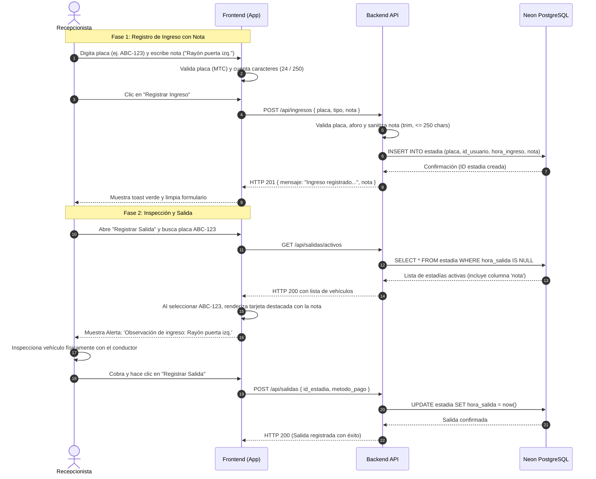

# Análisis y Diseño — Registro de Notas Vehiculares (UPAO-58 / UPAO-9)

**Historia de Usuario:** `UPAO-9` — Adjuntar notas (2 Story Points)  
**Subtarea:** `UPAO-58` — Análisis y diseño del registro de notas vehiculares (5h)  
**Épica:** `UPAO-26` — Operación y Control de la cochera  
**Responsable asignado:** ALBERTH JAIR FLORES LEONARDO  
**Fecha:** 24/10/2026  
**Estado:** Documentado y Aprobado

---

## 1. Objetivo y Justificación

### 1.1. Objetivo
Definir los requerimientos técnicos, modelo de datos relacional, reglas de negocio de inmutabilidad, mecanismo de auditoría y flujo de visualización para que el recepcionista pueda registrar notas u observaciones sobre las condiciones físicas del vehículo al momento de su ingreso y visualizarlas obligatoriamente al procesar su salida.

### 1.2. Justificación de Negocio y Respaldo Legal
En la operación diaria de cocheras comerciales se presentan reclamos infundados de conductores que acusan al establecimiento por rayones, golpes, abolladuras o pérdida de accesorios. Contar con un campo de notas vinculado de forma inalterable a la estadía del vehículo:
- Otorga **protección legal** y transparencia a la cochera.
- Protege al conductor garantizando que las condiciones de su vehículo queden registradas con hora y responsable.
- Agiliza la inspección física antes del cobro y liberación de la salida.

---

## 2. Requerimientos y Criterios de Aceptación (UPAO-9)

| ID | Criterio de Aceptación | Solución de Análisis y Diseño |
|:---:|---|---|
| **CA-01** | Campo dedicado para notas en el módulo de Ingresos | Se añadirá un componente `<textarea>` con identificador `#input-notas-ingreso` en el formulario de registro de ingreso. |
| **CA-02** | Carácter opcional del campo | El campo no es obligatorio; si no se ingresa nada o solo espacios en blanco, el registro de ingreso se realiza con normalidad guardando valor `NULL` en la base de datos. |
| **CA-03** | Vinculación permanente al registro de la placa | La nota se almacenará como una columna directa dentro de la entidad `estadia`, ligada al `id_estadia` y la placa respectiva. |
| **CA-04** | Regla de Inmutabilidad (No editable ni eliminable) | La API no expondrá endpoints de modificación (`PUT`/`PATCH`) ni de borrado para este campo. Una vez guardado el ingreso, la nota queda congelada. |
| **CA-05** | Auditoría automática en segundo plano | El sistema captura automáticamente el `id_usuario` del recepcionista autenticado en sesión y el timestamp de `hora_ingreso` (hora de Perú `-05:00`). |
| **CA-06** | Visualización destacada en módulo de Salidas | Al buscar o seleccionar una placa en "Registrar Salida", el panel de cobro presentará una tarjeta destacada con la nota previa antes de confirmar el pago. |
| **CA-07** | Límite máximo de 250 caracteres | Restricción dual: atributo HTML `maxlength="250"` con contador interactivo en frontend y validación estricta de longitud en el backend (`HTTP 400`). |
| **CA-08** | Soporte de notas vacías o con espacios | Sanitización mediante `.trim()`. Si el resultado tiene longitud cero, se persiste como `NULL`. |

---

## 3. Modelo de Datos y Esquema Relacional

La columna se incorpora dentro de la tabla **`estadia`**, la cual ya centraliza las transacciones de entrada y salida del sistema:

```text
┌────────────────────────────────────────────────────────┐
│                        ESTADIA                         │
├────────────────────────────────────────────────────────┤
│ id_estadia       : INT (PK, AUTOINCREMENT)             │
│ placa            : VARCHAR(10) (NOT NULL)              │
│ id_tipo_vehiculo : INT (FK -> tipo_vehiculo)           │
│ id_tarifa        : INT (FK -> tarifa)                  │
│ id_usuario       : INT (FK -> usuario) [AUDITORÍA]     │
│ hora_ingreso     : TIMESTAMP (NOT NULL) [AUDITORÍA]    │
│ hora_salida      : TIMESTAMP (NULL = activa)           │
│ nota             : VARCHAR(250) (NULLABLE) [NUEVO]     │
└────────────────────────────────────────────────────────┘
```

### 3.1. Definición en Prisma Schema (`prisma/schema.prisma`)
```prisma
model Estadia {
  id              Int          @id @default(autoincrement()) @map("id_estadia")
  placa           String       @db.VarChar(10)
  idTipoVehiculo  Int          @map("id_tipo_vehiculo")
  idTarifa        Int          @map("id_tarifa")
  idUsuario       Int          @map("id_usuario")
  horaIngreso     DateTime     @default(now()) @map("hora_ingreso")
  horaSalida      DateTime?    @map("hora_salida")
  nota            String?      @db.VarChar(250) @map("nota")

  tipoVehiculo    TipoVehiculo @relation(fields: [idTipoVehiculo], references: [id])
  tarifa          Tarifa       @relation(fields: [idTarifa], references: [id])
  usuario         Usuario      @relation(fields: [idUsuario], references: [id])
  pago            Pago?

  @@map("estadia")
}
```

---

## 4. Reglas de Negocio y Mecanismos de Seguridad

### 4.1. Regla de Inmutabilidad
1. El campo `nota` **solo se escribe durante la operación de inserción** (`POST /api/ingresos`).
2. La API no proveerá ningún endpoint de actualización (`PUT /api/ingresos/:id/nota` o similar).
3. Si un usuario intenta enviar un campo `nota` en la petición de salida (`POST /api/salidas`), el backend lo ignora.
4. Cualquier alteración posterior a la confirmación del ingreso es considerada una violación de integridad del registro legal.

### 4.2. Mecanismo de Auditoría Automática
- Al procesar el registro de ingreso, el backend extrae el identificador del recepcionista de la sesión autenticada (`req.usuario.id` o token).
- Se almacena:
  - `id_usuario`: Llave foránea del recepcionista responsable del turno.
  - `hora_ingreso`: Fecha y hora exacta generada por el servidor (no manipulable desde el cliente).
- El recepcionista no necesita digitar su nombre ni su turno; todo queda asociado de manera transparente.

---

## 5. Flujo de Datos y Navegación del Usuario



---

## 6. Especificación de Endpoints y Contratos de Datos

### 6.1. Endpoint de Registro de Ingreso
* **Método y Ruta:** `POST /api/ingresos`
* **Headers:** `Content-Type: application/json`
* **Request Body:**
  ```json
  {
    "placa": "ABC-123",
    "tipo": "auto",
    "nota": "Abolladura leve en parachoques delantero y sin espejo retrovisor derecho."
  }
  ```
* **Lógica de Validación en Backend:**
  ```javascript
  const notaSanitizada = typeof req.body.nota === 'string' ? req.body.nota.trim() : null;
  if (notaSanitizada && notaSanitizada.length > 250) {
    return res.status(400).json({ error: 'La nota no puede exceder los 250 caracteres.' });
  }
  const notaFinal = (notaSanitizada && notaSanitizada.length > 0) ? notaSanitizada : null;
  ```
* **Respuesta Exitosa (`HTTP 201 Created`):**
  ```json
  {
    "mensaje": "Ingreso registrado correctamente.",
    "ingreso": {
      "id": 14,
      "placa": "ABC-123",
      "tipo": "Automóvil / Camioneta",
      "hora_ingreso": "24/10/2026 23:25",
      "nota": "Abolladura leve en parachoques delantero y sin espejo retrovisor derecho."
    }
  }
  ```

---

### 6.2. Endpoint de Consulta de Vehículos Activos para Salida
* **Método y Ruta:** `GET /api/salidas/activos`
* **Respuesta Exitosa (`HTTP 200 OK`):**
  ```json
  [
    {
      "id": 14,
      "placa": "ABC-123",
      "tipo": "Automóvil / Camioneta",
      "hora_ingreso": "2026-10-24T23:25:00.000Z",
      "hora_ingreso_formato": "23:25",
      "tarifa_hora": "4.50",
      "tarifa_fraccion": "2.50",
      "nota": "Abolladura leve en parachoques delantero y sin espejo retrovisor derecho.",
      "usuario_ingreso": "Recepcionista Turno Noche"
    }
  ]
  ```

---

## 7. Lineamientos de Interfaz (UI / UX)

Siguiendo la [Guía de Estilos y Lineamientos de Interfaz](../../diseño/Guía%20de%20Estilos%20y%20Lineamientos%20de%20Interfaz.md):

### 7.1. En la pantalla "Registrar Ingreso"
- **Elemento:** `<textarea id="input-nota-ingreso" class="input-control" rows="2" maxlength="250" placeholder="Ej. Rayón en puerta derecha, faro izquierdo rajado (opcional)...">`.
- **Tipografía:** Geist Sans 14px para texto; JetBrains Mono para el contador.
- **Contador dinámico:** Contenedor interactivo abajo a la derecha del campo que actualiza en tiempo real: `<span id="contador-nota">0/250</span>`. Si llega a 250, el texto cambia a color ámbar corporativo (`#F59E0B`).
- **Comportamiento opcional:** El campo no tiene asterisco rojo (`*`). El botón "Registrar Ingreso" opera idénticamente si el campo está vacío.

### 7.2. En la pantalla "Registrar Salida"
- **Elemento:** Contenedor de alerta en el bloque `Resumen de Salida`:
  - Si el vehículo **tiene nota registrada**: Se despliega una tarjeta con borde de acento ámbar (`#F59E0B`), fondo suave `#FEF3C7` y título `📝 Observación registrada al ingreso:`.
  - Si el vehículo **no tiene nota**: Muestra la leyenda en tono neutral `#6B7280`: `Sin observaciones registradas al ingreso`.

---

## 8. Criterios para la Fase de Pruebas (Matriz de Casos de Prueba Previstos)

Esta definición técnica servirá como base directa para la subtarea de pruebas:

1. **CP-01:** Registrar ingreso con nota válida de 50 caracteres → Guarda en BD y respuesta `201`.
2. **CP-02:** Registrar ingreso dejando el campo de notas vacío → Guarda `NULL` y no interrumpe el flujo.
3. **CP-03:** Registrar ingreso con nota de puros espacios (`"     "`) → Sanitiza a `NULL` sin errores.
4. **CP-04:** Validar límite estricto en frontend (no permite teclear más de 250 caracteres y contador muestra 250/250).
5. **CP-05:** Validar rechazo de backend si se envían >250 caracteres por API (debe retornar `HTTP 400`).
6. **CP-06:** En el módulo de salida, buscar un vehículo con nota y verificar que la tarjeta de observación se despliegue íntegra.
7. **CP-07:** Verificar inmutabilidad: confirmar que no haya ningún botón para editar la nota en la pantalla de salida ni endpoint accesible.

---

## 9. Trazabilidad con Jira
- Subtask vinculada: **`UPAO-58`** (Análisis y diseño del registro de notas vehiculares).
- Parent Story: **`UPAO-9`** (Adjuntar notas).
- Entregable: Archivo de especificación `docs/modulos/ingreso/analisis-notas.md` versionado en Git.
