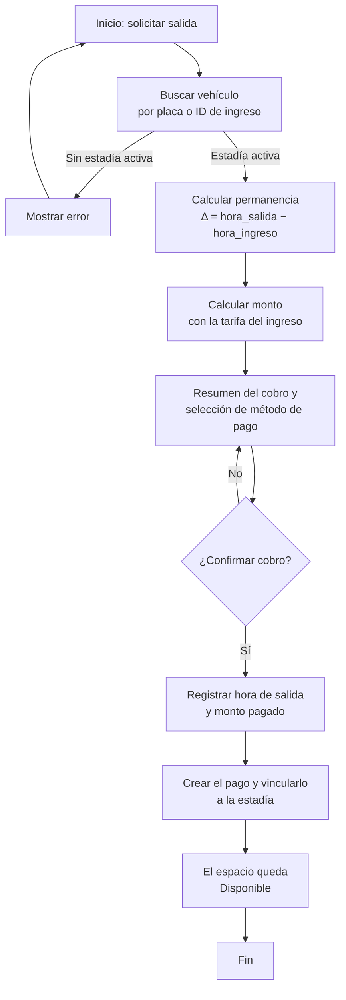

# Módulo Salida — Análisis y Diseño (UPAO-43)

> Historia: **UPAO-7 Registrar salida** · Subtarea **UPAO-43 (Análisis y Diseño)** · Sprint 1.

## 1. Objetivo

Definir la **estructura de datos** del historial de salidas y la **lógica de cálculo del tiempo y del monto** (fracciones de hora) para el registro de salida y cobro.

## 2. Alcance

- Registro de salida y cobro: buscar el vehículo, calcular el monto, seleccionar el método de pago y registrar la hora de salida y el monto.
- Estructura de datos del historial de salidas.

**Fuera de alcance:** reportes de ingresos recaudados (UPAO-17), reservas/anulación y el bloqueo por aforo.

## 3. Datos de la salida (estructura)

La salida **completa la estadía** y genera un **pago** (relación 1:1).

| Dato | Dónde | Detalle |
| --- | --- | --- |
| Placa | `estadia.placa` | Del ingreso |
| Hora de entrada | `estadia.hora_ingreso` | Del ingreso |
| Hora de salida | `estadia.hora_salida` | Se completa al registrar la salida |
| Tiempo de permanencia | `pago.tiempo_horas` + `pago.tiempo_fraccion` | Horas completas + fracción |
| Tarifa aplicada | `estadia.id_tarifa` → `tarifa` | La tarifa del ingreso (`precio_hora`, `precio_fraccion`) |
| Monto cobrado | `pago.monto` | Calculado |
| Método de pago | `pago.id_metodo_pago` → `metodo_pago` | Seleccionado por el recepcionista |

Tablas implicadas: **`estadia`**, **`pago`**, **`metodo_pago`**, **`tarifa`**.

## 4. Lógica de cálculo del tiempo y del monto

Sea `Δ = hora_salida − hora_ingreso` (en horas):

- `tiempo_horas` = parte entera de `Δ`.
- `tiempo_fraccion` = parte decimal de `Δ` (de `0` a `<1`).
- `monto = tiempo_horas × tarifa.precio_hora + fracción(...)`.

**Regla de la fracción (a confirmar con el equipo/profesor):**

- **(A)** cada fracción iniciada cobra el `precio_fraccion` completo (ej. 1 h 10 min → `1 × 4.50 + 2.50`).
- **(B)** proporcional: `tiempo_fraccion × precio_fraccion` (ej. `0.5 × 2.50`).

## 5. Flujo del registro de salida

1. Buscar el vehículo por **placa** o **ID de ingreso** (estadía activa, `hora_salida IS NULL`).
2. El sistema calcula el **tiempo** y el **monto** con la tarifa del ingreso.
3. El recepcionista selecciona el **método de pago**.
4. Confirmar → registra `hora_salida`, crea el `pago` y vincula `estadia.id_pago`.
5. El espacio queda **Disponible** (la estadía deja de estar activa).

> **Nota:** `estadia` no tiene columna de "estado": el estado se **deriva** de `hora_salida` (`NULL` = activa). Registrar la salida = escribir `hora_salida` + crear el `pago` (vinculado por `id_pago`). No se integra una pasarela de pago: solo se **registra** el método de pago y el monto.

## 6. Modelo de datos (referencia)

- `estadia.hora_salida` (`NULL` = activa) y `estadia.id_pago` (1:1 con `pago`).
- `pago`: `monto`, `tiempo_horas`, `tiempo_fraccion`, `id_metodo_pago`, `fecha_hora`.
- `metodo_pago`: catálogo (Efectivo, Yape, POS…).
- Diagrama: [`diagrama-er.erd`](../../datos/diagrama-er.erd) · modelo completo: [`Modelo_de_Datos.md`](../../datos/Modelo_de_Datos.md).

## 7. Preguntas abiertas

1. **Regla de la fracción** (A o B) — define el cálculo del monto.
2. **Tarifas de madrugada / reservas:** el modelo solo tiene `tarifa` por tipo de vehículo (incluye "Reserva Web"); **no** hay tarifa por franja horaria (madrugada). ¿Se requiere?
3. **"Espacio disponible":** es **derivado** (la estadía deja de estar activa), no un campo aparte (el aforo se controla por totales y entradas activas).

## 8. Referencias

- [Modelo de datos](../../datos/Modelo_de_Datos.md) · [Guía de Estilos](../../diseño/Guía%20de%20Estilos%20y%20Lineamientos%20de%20Interfaz.md).
- Módulo de ingreso: [análisis](../ingreso/analisis.md) · [API](../ingreso/api.md).
